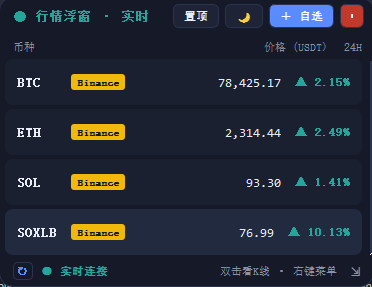
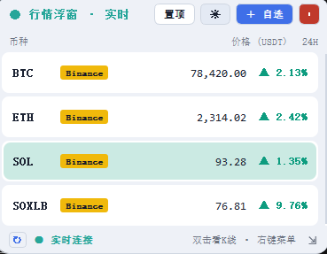
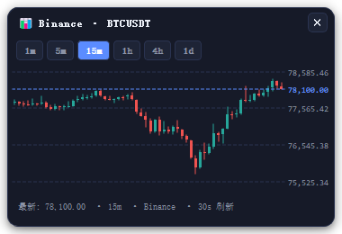

# Market Float Widget

> A lightweight always-on-top market widget for continuous market awareness — without switching back to a full trading terminal.



[中文文档](README_CN.md)

---

## Why I Built This

While trading, my screen usually holds TradingView, an exchange, a browser, research docs, chat, and work software — all at once. Most of the time I don't need deep analysis. I just want to know:

- What are BTC / ETH / SOL doing right now?
- Did the market just move in a way worth my attention?

Opening a full trading terminal to answer that is heavy: too much information, and it breaks whatever workflow I'm in. So instead of building another dashboard, I built the opposite — a small, persistent, glanceable layer that sits on top of everything else.

**Glanceable information, instead of another full dashboard.**

## Product Principles

- **Glanceable** — Market state readable in under 3 seconds.
- **Lightweight** — It does not try to replace a trading terminal.
- **Always available** — Always-on-top, lives in the tray, near-zero cost to check.
- **Signal over noise** — Only what matters: price, 24h change, source, alerts.

## Features

- **Real-time quotes** — WebSocket push from Binance, OKX and Bitget; defaults to BTC / ETH / SOL on Binance.
- **Multi-exchange watchlist** — 3–10 symbols, each pinned to its own exchange, with branded exchange badges.
- **Resilient connectivity** — WebSocket-first with multi-endpoint failover and connect watchdog; automatic REST polling fallback with periodic WS retry. Status is always visible (live / polling / reconnecting).
- **Frameless floating window** — Always-on-top toggle, drag anywhere, resize from any edge or corner, scrollable list.
- **Price alerts** — Above / below triggers per symbol, tray notification, sound, and row flash.
- **Mini candlestick chart** — Double-click any row; 1m / 5m / 15m / 1h / 4h / 1d intervals, fetched from that symbol's own exchange, auto-refresh every 30s.
- **Dark / light theme** — One-click toggle, persisted across restarts.
- **System tray mode** — Close to tray, right-click menu, manual refresh button.
- **Windows packaging support** — PyInstaller configuration included; the EXE still needs build and acceptance checks before release.

| Light theme | Mini chart |
|---|---|
|  |  |

## How It Works

```
Exchange WebSocket ──► per-exchange worker thread ──► Qt signal ──► row UI update
        │ fails / blocked                                  ▲
        └─► REST polling fallback (requests + 2.5s wait, WS retried) ─────┘

K-line window: REST candles from the symbol's own exchange, refreshed every 30s.
Alerts: one-shot >= / <= thresholds checked on valid quotes; removed after triggering.
Stale quotes do not trigger alerts. Notification: tray + sound + row flash.
Config: ~/.crypto_float_config.json (watchlist, alerts, window position, theme).
```

No API keys are needed — all data comes from public market-data endpoints.

## Tech Stack

- **Python 3** · **PyQt5** — frameless translucent desktop UI
- **websocket-client** — real-time streams (Binance / OKX / Bitget)
- **urllib (stdlib)** — REST fallback + klines
- **PyInstaller** — single-file Windows packaging

## Getting Started

### Run from source

Extract the source ZIP and open PowerShell in the folder containing `crypto_float.py`.

```powershell
py -3.12 -m venv .venv
.\.venv\Scripts\python.exe -m pip install -r requirements.txt
.\.venv\Scripts\python.exe crypto_float.py
```

Target environment: Windows x64 with Python 3.12. The UI is currently Chinese. Only exchange-listed USDT spot pairs are supported; enter a base symbol such as BTC. Network access to public exchange endpoints is required. See [release checks](RELEASE_CHECKLIST.md) for validation status.

### Build the Windows exe

```powershell
.\.venv\Scripts\python.exe -m pip install -r requirements-build.txt
.\.venv\Scripts\python.exe -m PyInstaller --clean --noconfirm crypto_float.spec
```

The output is `dist/crypto_float.exe`; Python is not required on the target machine. Supported Windows versions and architecture must be recorded in each tested release. The current build is v0.1.0-rc.1. Complete licensing and clean-machine checks in [distribution notes](DISTRIBUTION.md) before publishing.

### Configuration

Everything is stored in `~/.crypto_float_config.json` (created on first run): watchlist, alerts, window position, theme. To migrate to a new machine, copy the exe and (optionally) this file.

## Product Decisions

### Why a floating widget instead of another dashboard?

This project is not about providing *more* data. It's about lowering the **operational cost of checking market state**.

A full dashboard is the right interface for deep analysis, charting, and order placement. A float widget is the right interface for a different task: confirming "is anything happening right now?" while doing something else. Different interface for a different user task — the widget deliberately shows less, so you can keep doing what you were doing.

### Why WebSocket *and* REST?

Real networks (corporate proxies, some ISPs, certain regions) block or reset exchange WebSocket endpoints. The worker tries multiple WS endpoints with a connect watchdog, and degrades to REST polling instead of dying — with a visible status indicator, and marks data unavailable after 30 seconds without a valid quote, including partial source outages.

### Why 3–10 symbols?

Three is the smallest meaningful market read (BTC / ETH / SOL). Ten is the upper bound of "glanceable". Beyond that, you're building a watchlist app — a different product.

## Roadmap

The functionality above is implemented; see [release checks](RELEASE_CHECKLIST.md) for the actual validation scope. The following are **Planned / Exploring**:

- Compact / expanded display modes
- BTC / ETH / SOL relative-strength view
- Keyboard shortcut to show / hide
- More data sources (aggregated indices, funding rates)
- Market event radar integration
- Portable config export / import

## AI-assisted Development

This project was designed and built through an AI-assisted development workflow. The product problem, scope, interaction model and trade-offs are my own decisions; a coding agent assisted with implementation, debugging and iteration. I treat AI as leverage for building products, not as a substitute for product thinking.

## About

One small experiment in building tools around my own trading workflow — part of a personal trading toolset I'm building in the open.

## Privacy and limitations

No accounts or API keys are needed, and there is no order placement. Exchanges receive your network address and requested market pairs. Watchlists, alerts and position are stored as plain text in `%USERPROFILE%/.crypto_float_config.json` and are not uploaded by this app. TLS certificate verification stays enabled; proxies need a correctly configured trust chain. Windows settings may suppress sound or notifications; alert delivery is not guaranteed. Screenshots illustrate the UI and do not show current quotes.

## License and release status

Haonan build licenses the original project source under the [MIT License](LICENSE). The combined application containing GPL PyQt5 is planned for distribution as a whole under GPL-3.0-only. Third-party components retain their own licenses. The root MIT grant is limited to the original project source and does not cover the combined EXE as a whole. Public EXE distribution requires completing applicable third-party notices, license texts, Corresponding Source and other distribution obligations. See [Distribution](DISTRIBUTION.md).

The compatibility build passed Windows testing for Binance, OKX and Bitget live quotes, chart interval switching, restart and configuration persistence. WebSocket uses the configured Windows HTTP CONNECT proxy with TLS certificate and hostname verification enabled. All 31 automated regressions passed. Clean Windows validation of the RC EXE is Not Tested. The initial repository publication covers source only. See the [release checklist](RELEASE_CHECKLIST.md).
