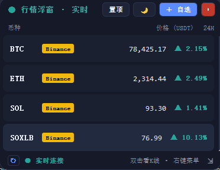
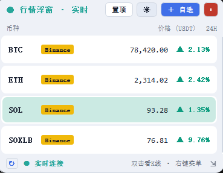
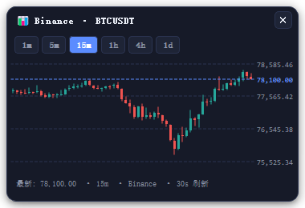

# Market Float Widget（行情浮窗）

> 一个轻量、常驻、可快速扫一眼的行情浮窗——让你持续感知市场状态，而不必频繁切回完整的交易终端。



[English README](README.md)

---

## 为什么做这个

交易时，我的屏幕上通常同时开着：TradingView、交易所、浏览器、研究文档、聊天和办公软件。但大多数时候我并不需要深度分析，只是想确认：

- BTC / ETH / SOL 现在什么价？
- 市场刚才有没有发生值得注意的波动？

为了这点信息去打开完整的行情终端，成本太高：信息密度过大，还会打断当前的工作流。所以这个项目没有做成又一个 Dashboard，而是做成了它的反面——一个常驻在所有窗口之上的轻量浮层。

**可扫读的信息，而不是又一个完整的仪表盘。**

## 产品原则

- **可扫读（Glanceable）**——3 秒内读完市场状态。
- **轻量（Lightweight）**——不试图替代完整的交易终端。
- **始终可用（Always Available）**——置顶、托盘常驻，查看行情的操作成本趋近于零。
- **信号优先于噪音（Signal over Noise）**——只展示当前真正有用的信息：价格、24H 涨跌、数据来源、报警。

## 功能

- **实时行情**——币安 / OKX / Bitget WebSocket 推送，默认 BTC / ETH / SOL（币安）。
- **多交易所自选**——3–10 个标的，每个标的绑定自己的交易所，带品牌徽标。
- **连接韧性**——WebSocket 优先，多端点自动切换 + 连接看门狗；连不上自动降级 REST 轮询并定期重试，连接状态（实时 / 轮询 / 重连）始终可见。
- **无边框浮窗**——置顶开关、任意拖拽移动、边缘/角落缩放、列表可滚动。
- **价格报警**——按标的设置涨破/跌破，托盘通知 + 提示音 + 行闪烁。
- **迷你 K 线**——双击任意行打开；1m / 5m / 15m / 1h / 4h / 1d 周期，按该标的所属交易所拉取，30 秒自动刷新。
- **暗色 / 亮色主题**——一键切换，重启后保留。
- **系统托盘**——关窗缩进托盘、右键菜单、左下角手动刷新按钮。
- **Windows 打包支持**——提供 PyInstaller 配置；EXE 发布前仍需构建和验收。

| 亮色主题 | 迷你 K 线 |
|---|---|
|  |  |

## 工作原理

```
交易所 WebSocket ──► 每交易所独立工作线程 ──► Qt 信号 ──► 行情行更新
        │ 失败 / 被阻断                              ▲
        └─► REST 轮询兜底（请求完成后等待 2.5 秒，定期重试 WS）──┘

K 线窗口：按标的所属交易所 REST 拉取，30 秒刷新。
价格报警：有效行情到达时判定一次性 ≥ / ≤ 阈值，触发后删除；过期行情不触发。托盘通知 + 提示音 + 行闪烁。
配置持久化：~/.crypto_float_config.json（自选、报警、窗口位置、主题）。
```

无需 API Key——所有数据来自交易所公开行情接口。

## 技术栈

- **Python 3** · **PyQt5**——无边框半透明桌面 UI
- **websocket-client**——实时行情流（币安 / OKX / Bitget）
- **urllib（标准库）**——REST 兜底与 K 线
- **PyInstaller**——单文件 Windows 打包

## 快速开始

### 从源码运行

解压源码 ZIP，在包含 `crypto_float.py` 的目录打开 PowerShell。

```powershell
py -3.12 -m venv .venv
.\.venv\Scripts\python.exe -m pip install -r requirements.txt
.\.venv\Scripts\python.exe crypto_float.py
```

目标运行环境：Windows x64、Python 3.12。当前界面为中文，仅支持交易所提供的 USDT 现货交易对；添加时输入基础币种符号（例如 BTC）。需要能访问交易所公开行情接口的网络环境。完整验证状态见 [发布检查](RELEASE_CHECKLIST.md)。

### 打包 Windows exe

```powershell
.\.venv\Scripts\python.exe -m pip install -r requirements-build.txt
.\.venv\Scripts\python.exe -m PyInstaller --clean --noconfirm crypto_float.spec
```

产物为 `dist/crypto_float.exe`，目标电脑无需安装 Python。支持的 Windows 版本和架构须以对应 Release 的实测说明为准；当前构建标识为 v0.1.0-rc.1。发布前请完成授权材料和干净机器验证，见 [分发说明](DISTRIBUTION.md)。

### 配置与迁移

所有配置存放在 `~/.crypto_float_config.json`（首次运行自动生成）：自选列表、报警、窗口位置、主题。换电脑时复制 exe 即可，想保留自选和报警就再带上这个文件。

## 产品决策

### 为什么是浮窗，而不是又一个 Dashboard？

这个项目的目标不是提供*更多*数据，而是降低**"确认市场状态"的操作成本**。

完整 Dashboard 适合深度分析、画图、下单；浮窗适合的是另一类任务：在做别的事情的同时，快速确认"市场现在有没有动静"。不同的用户任务，对应不同的界面——浮窗故意展示得更少，这样你才能继续做手头的事。

### 为什么 WebSocket 和 REST 都要？

真实网络环境（企业代理、部分运营商、部分地区的网络策略）会阻断交易所的 WebSocket 端点。Worker 会按优先级尝试多个 WS 端点并带连接看门狗，连不上就降级为 REST 轮询而不是直接挂掉，同时状态栏始终可见——30 秒未收到有效行情时显示不可用；混合来源会显示部分不可用。

### 为什么标的限定 3–10 个？

3 个是有意义的市场感知下限（BTC / ETH / SOL），10 个是"可扫读"的上限。超过这个范围，那就是一个自选管理应用了——是另一种产品。

## 路线图

以上为当前实现的功能；实际验证范围见 [发布检查](RELEASE_CHECKLIST.md)。以下为 **Planned / Exploring**：

- 紧凑 / 展开两种显示模式
- BTC / ETH / SOL 相对强弱视图
- 显示 / 隐藏快捷键
- 更多数据源（聚合指数、资金费率）
- 市场事件雷达集成
- 配置导出 / 导入

## AI 辅助开发

本项目通过 AI 辅助开发流程完成设计与实现。产品问题、范围、交互模型与取舍均由我本人定义；编码 Agent 辅助了实现、调试与迭代。我把 AI 当作构建产品的杠杆，而不是产品思考的替代品。

## 关于

这是我围绕个人交易工作流构建工具的一次小型实验——我正在公开构建的个人交易工具集的一部分。

## 隐私与限制

无需账号或密钥，不包含下单功能；程序向交易所请求行情，交易所能看到网络地址和请求的交易对。自选、报警和位置以明文保存在 `%USERPROFILE%/.crypto_float_config.json`，不由程序上传。证书校验始终开启；代理环境需正确配置可信证书。系统通知或声音可能受 Windows 设置影响，报警不保证送达。截图仅用于界面展示，价格并非当前报价。

## 授权与发布状态

项目自有源码由 Haonan build 依 [MIT License](LICENSE) 授权。包含 GPL 版 PyQt5 的组合应用计划整体按 GPL-3.0-only 分发，各第三方组件仍适用其各自的许可证。根目录 MIT 文件的授权范围仅为项目自有源码，不覆盖整个组合 EXE。公开 EXE 前须完成适用的第三方版权声明、许可证、对应源码及其他分发义务。见 [分发说明](DISTRIBUTION.md)。

兼容修复版已在 Windows 实机通过 Binance、OKX、Bitget 实时行情、K 线切换、重启与配置保存。WebSocket 使用 Windows 已配置的 HTTP CONNECT 代理，TLS 证书与主机名校验保持开启。31 项自动回归已通过。RC EXE 的干净 Windows 验收为 Not Tested。首次仓库公开以源码为范围，发布条件见 [发布检查清单](RELEASE_CHECKLIST.md)。
